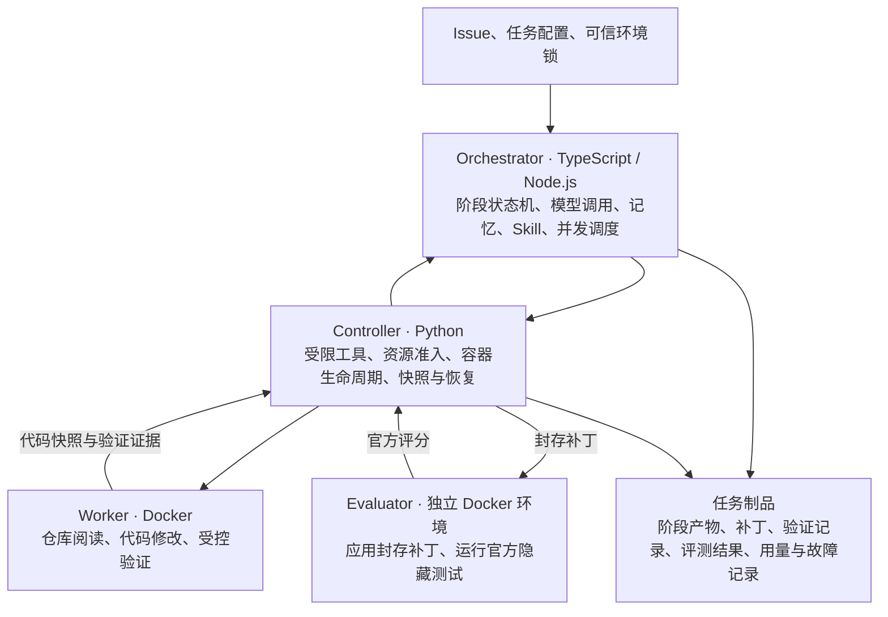

# RepoFixLab

基于 Pi Agent 二次开发的代码修复智能体，构建从问题理解、补丁生成到独立评测的可信闭环。

项目围绕三个方向持续迭代：**修复质量、上下文效率、多任务运行效率与故障恢复**。

**技术栈：** TypeScript、Node.js、Python、ReAct、Docker、SFT、DPO、LoRA。

## 项目背景与目标

通用代码智能体能够修改代码，但修复结果还需要回答几个具体问题：

- 补丁是否解决了原始问题？
- 修复是否破坏了已有功能？
- 验证是否使用了准确的代码版本和测试环境？
- 多个任务同时运行时，资源是否可控？
- 容器或基础设施发生故障后，任务能否保留进度并继续执行？

RepoFixLab 将修复过程组织为具有明确职责、结构化产物和验证边界的工作流，并通过隔离容器、补丁快照和官方测试，将修改过程与验收结果关联起来。

项目使用 SWE-bench Multilingual 中冻结的 **26 个真实 JavaScript／TypeScript 问题**验证修复能力，并使用独立实验评估 PLAN 后训练、上下文记忆和容器运行效率。

## 核心成果

| 方向 | 结果 |
| --- | --- |
| 代码修复 | 26 个任务的阶段累计成功数由 **18/26 → 24/26 → 26/26** |
| 回归保持 | 达到 24/26 的阶段，官方测试结果为 **F2P 30/32、P2P 592/592** |
| 上下文效率 | 记忆专项实验中，Token 消耗降低约 **10%**，输入缓存命中率由 **22.2% 提升至约 68%** |
| PLAN 后训练 | 50 条冻结测试上，Qwen3-4B 的 PLAN 有效通过率由基础模型的 **0%**，经 SFT 提升至 **14%**，再经 DPO 提升至 **32%** |
| 并发验证 | 12 个固定补丁回放样本，整批耗时由 **1074.80 秒降至 840.29 秒**，耗时降低约 **22%**，吞吐提升约 **28%** |
| 容器复用 | 同一批样本中，Worker 与 Evaluator 的角色容器创建次数由 **24 次降至 14 次** |
| 失败续跑 | 支持检查点恢复、等待轮询和确定性回退；通过专项测试及真实 Docker 故障注入验证 |

修复成功数按同一组 26 个任务历次有效正式评测结果汇总。PLAN 后训练和容器性能实验分别使用独立样本与指标。

## 系统架构



| 层级 | 职责 |
| --- | --- |
| **编排层 Orchestrator** | 调用模型，推进七阶段状态机，组装记忆上下文，注入 PLAN Skill，管理用量与批量任务 |
| **控制层 Controller** | 独占 Docker 权限与容器终止权，校验环境身份，执行固定工具协议，管理资源、快照、容器池与故障处置 |
| **执行层 Worker** | 在隔离环境内读取仓库、修改代码并提交阶段产物，通过控制层执行允许的工具与验证 |
| **评估层 Evaluator** | 在独立干净环境中应用封存补丁和官方测试材料，输出 F2P、P2P 与任务判定 |

Worker 不持有模型凭据或 Docker socket。Controller 统一管理工具权限、网络、挂载和资源限制。官方隐藏测试材料由评估层管理。

## 修复工作流与验收

修复任务按七个阶段执行：

```text
UNDERSTAND → LOCALIZE → PLAN → IMPLEMENT → REFINE_1 → REFINE_2 → SELF_REVIEW
   理解         定位       计划       实现          修正一        修正二         自审
```

每个阶段提交结构化产物，通过校验后才能进入下一阶段。

- **UNDERSTAND／LOCALIZE：** 整理问题行为、代码证据、候选位置与相关调用关系。
- **PLAN：** 明确修改范围、实现义务、状态约束和验证方式。
- **IMPLEMENT：** 按计划生成初始补丁，并执行受控验证。
- **REFINE_1／REFINE_2：** 根据验证证据修正实现，分别形成新的验证结果。
- **SELF_REVIEW：** 检查计划义务、代码范围与最终验证结果的一致性，封存最终补丁。

阶段交接保留结构化信息、压缩视图与哈希引用。最终送入 Evaluator 的补丁与封存快照绑定。

官方验收包括：

- **F2P（Fail to Pass）：** 原本失败的目标测试转为通过。
- **P2P（Pass to Pass）：** 原本通过的测试继续通过。

任务成功要求规定的 F2P 与 P2P 均满足通过条件。

## 迭代轨迹

### 1. 建立修复与独立验收闭环

首先建立七阶段状态机与四层架构，将仓库操作、阶段产物、代码快照、受控验证和官方评分串联起来。

这一阶段主要解决修复过程的可控性与结果的可追溯性：

- 每个阶段具有明确职责和完成条件。
- 仓库修改通过受限工具执行。
- 补丁、验证记录和正式评测绑定准确的任务与代码身份。
- 官方评测使用独立环境运行。

后续通过工作流、验证和记忆机制的持续迭代，26 个任务的累计成功数由 **18 个提升至 24 个**。

### 2. 设计分层记忆与上下文构建机制

随着任务轮数增加，完整历史会持续占用上下文；压缩历史又可能丢失代码证据、候选位置和阶段结论。

项目设计了三层记忆：

| 层级 | 内容 | 用途 |
| --- | --- | --- |
| **工作记忆 L0** | 当前阶段所需的代码片段、证据与近期交互 | 支持当前决策 |
| **阶段记忆 L1** | 已校验的阶段产物、候选集合与证据引用 | 支持阶段交接 |
| **任务记忆 L2** | 原始交互、工具结果、代码修改、验证及压缩记录 | 支持追溯与按需读取 |

上下文按 **checkpoint + delta** 组装：

- checkpoint 保存当前模型输入的稳定基础。
- 普通轮次追加新消息与工具结果。
- 阶段切换、仓库版本变化或压缩完成时，按需要重建 checkpoint。
- 滚动压缩结合上一版摘要与新增内容，并检查证据覆盖情况。

记忆专项实验中，Token 消耗降低约 **10%**；调整上下文重建方式后，输入缓存命中率由 **22.2% 提升至约 68%**。

### 3. 通过 SFT 与 DPO 改善 PLAN 质量

剩余失败案例暴露出计划阶段的共性问题：遗漏验收条件、证据关联不足、状态变化方向错误，以及验证场景与问题触发条件不一致。

后训练聚焦 PLAN 阶段，以 Issue、前序阶段产物和代码证据作为输入，生成结构化修复计划。

实验构建了：

- **410 条 SFT 样本**：315 条训练、45 条验证、50 条测试。
- **300 对 DPO 偏好样本**：270 对训练、30 对验证。
- 按仓库划分数据，覆盖 C、Go、Java、JavaScript、TypeScript。
- 使用 Qwen3-1.7B／4B、LoRA 和 LLaMA-Factory 完成训练与比较。

Qwen3-4B 在 50 条冻结 PLAN 测试上的结果：

| 模型 | 协议通过率 | 原子语义项正确率 | PLAN 有效通过率 |
| --- | ---: | ---: | ---: |
| 基础模型 | 6% | 2.75% | 0% |
| SFT | 74% | 40.75% | 14% |
| SFT → DPO，β=0.1 | **86%** | **51.50%** | **32%** |

每条测试包含 8 项语义检查。PLAN 有效通过要求输出协议正确，并通过该任务全部语义项。

### 4. 将稳定经验沉淀为 PLAN Skill

结合后训练实验和失败归因，将稳定规律整理为 `plan-robustness-v1` Skill，仅在 PLAN 阶段注入。

Skill 重点约束：

- **证据关联：** 将路径、代码行为与问题现象关联起来。
- **修改范围：** 区分必须修改、只需阅读和排除的位置。
- **实现义务：** 保留完成修复所需的最小完整条件。
- **状态语义：** 写明允许与禁止的状态变化。
- **验证对应：** 对齐触发条件、前置状态与可观察结果。

Skill 通过现有 PLAN 产物协议生效。PLAN 完成后，后续阶段依据计划实现和修正代码。

经过这一轮迭代，26 个任务的累计成功数由 **24 个提升至 26 个**。

### 5. 引入多任务并发、预热池与重置复用

多任务串行验证会重复等待容器准备和测试执行。项目增加了有界并发调度，并将 Worker、Evaluator 及辅助容器纳入 CPU／内存准入控制。

调度同时检查两个条件：

1. 当前运行任务数是否达到并发上限。
2. 剩余资源额度是否足以启动下一阶段所需的容器。

资源不足时进入队列；资源释放后继续调度。

实现了三种并发运行方式：

| 方式 | 容器获取与结束方式 |
| --- | --- |
| **并发按需** | 任务需要时创建新容器，使用结束后销毁 |
| **并发预热池** | 提前准备容器，任务领取后使用一次并销毁；池未命中时按需创建，后续需求可继续触发预热 |
| **并发重置复用** | 使用结束后清理并恢复容器，通过完整校验后归还池，供后续兼容任务领取 |

Worker 与 Evaluator 分别管理容器池。领取时检查环境兼容性和租约身份；复用前恢复工作树、依赖与可写状态，并校验残留文件、进程和输入输出。

#### 性能结果

每种模式运行相同的 **12 个固定补丁回放样本**，包含 9 个成功补丁样本和 3 个空补丁反例。

实验使用已缓存镜像，整批时间包含预热、重置、领取校验、验证、归档与清理成本。

| 模式 | 并发上限 | 整批耗时 | 吞吐 |
| --- | ---: | ---: | ---: |
| 串行按需 | 1 | 1074.80 秒 | 0.67 任务／分钟 |
| **并发按需** | **2** | **840.29 秒** | **0.86 任务／分钟** |
| 并发预热池 | 2 | 926.53 秒 | 0.78 任务／分钟 |
| 并发重置复用 | 2 | 896.61 秒 | 0.80 任务／分钟 |

当前基准中，并发按需取得最高吞吐，相比串行耗时降低约 **22%**，吞吐提升约 **28%**。

重置复用将角色容器创建次数由 **24 次减少至 14 次**。完整重置与校验也产生开销，因此其价值需要结合环境初始化成本和任务兼容程度评估。

四种模式共完成 **48 次回放**，评分均符合预期，无基础设施错误，结束后无残留资源。

### 6. 补充运行时失败续跑机制

在并发调度和容器生命周期管理的基础上，补充两层故障处理：

- **运行环境层：** 处理资源等待、Docker 不可用、异常容器和清理失败。
- **任务执行层：** 处理 Worker 中断、快照保存异常和 Evaluator 基础设施故障。

实现以 **检查点、等待轮询和确定性规则**为核心，复用已有状态机、操作记录和快照能力。

| 情况 | 处理方式 |
| --- | --- |
| 池中没有兼容容器 | 正常按需创建 |
| 池中容器启动失败或发现污染 | 销毁异常容器，再按资源额度尝试按需创建 |
| 临时资源不足 | 排队等待，最长 5 分钟；超时后保留进度并阻塞任务 |
| Docker 不可用 | 暂停新调度，每 5 秒轮询，最长 5 分钟；恢复后核对现有状态并继续 |
| 镜像身份、内容校验或配置错误 | 阻塞并记录原因 |
| Worker 执行中退出 | 从最近有效检查点恢复代码、已完成阶段和验证进度；每个逻辑任务最多恢复 1 次 |
| 快照保存成功但响应丢失 | 查询并取回已有快照 |
| 确认快照未保存且 Worker 正常 | 保留当前代码，再尝试保存 1 次 |
| Evaluator 基础设施故障 | 清理后新建 Evaluator，使用同一封存补丁再评测 1 次 |
| 容器重置失败 | 销毁容器，保留已完成任务结果 |
| 容器销毁持续失败 | 隔离残留资源，保留相应资源占用记录与额度，等待后续清理；保留任务结果 |

运行检查点记录**代码快照、已校验阶段产物和验证进度**。上下文 checkpoint 记录**模型输入的稳定前缀**，两者分别服务于执行恢复和上下文构建。

恢复后继续推进原工作流，保留 PLAN 与两次 REFINE 的职责。官方测试判定为 unresolved 时，正常记录评测结果。

这一轮已通过 **102 项 Python 测试、65 项 TypeScript 测试**及 **4 项真实 Docker 故障注入验证**，覆盖异常池容器回退、Evaluator 重试、初始检查点恢复和封存补丁恢复。

## 代码与实验入口

| 内容 | 分支／入口 |
| --- | --- |
| 记忆系统迭代 | [codex/repofixlab-memory](https://github.com/huanghuadixuwu-coder/RepoFixLab/tree/codex/repofixlab-memory) |
| PLAN 后训练实验 | [posttrain](https://github.com/huanghuadixuwu-coder/RepoFixLab/tree/posttrain) |
| PLAN Skill | [codex/skill](https://github.com/huanghuadixuwu-coder/RepoFixLab/tree/codex/skill) |
| 容器并发与运行时工程 | [docker](https://github.com/huanghuadixuwu-coder/RepoFixLab/tree/docker) |
| 容器迭代规格与验收记录 | [运行时迭代文档](https://github.com/huanghuadixuwu-coder/RepoFixLab/blob/docker/docs/plans/repofixlab-runtime-iteration.md) |
| 固定补丁回放基准 | [Docker 基准说明](https://github.com/huanghuadixuwu-coder/RepoFixLab/blob/docker/packages/repofixlab/configs/benchmarks/docker-v1/README.md) |

容器并发迭代已提交至 `docker` 分支。最新失败续跑补充已在本地实现并通过验收，待提交同步。

RepoFixLab 基于 Pi Agent 开发，保留原项目的许可证与归属说明。
